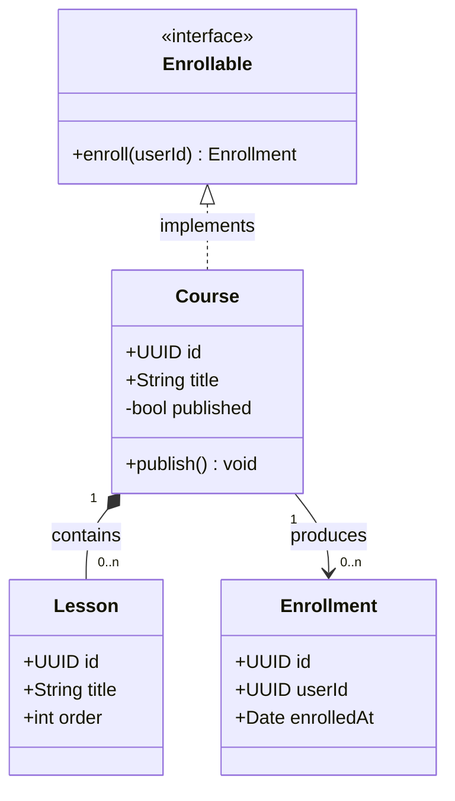

# Class Diagram

## When to use

The structure of objects and types and their relationships: domain classes, DTO hierarchies, service interfaces, and how they inherit from or compose one another. Use it when a plan introduces a set of related types and you want to show their shape and dependencies. For persistence models (tables and fields), use an [ER diagram](er-diagram.md); use a class diagram for code structure.

## Key syntax

- Declare the type: `classDiagram`.
- **Members** with visibility: `+` public, `-` private, `#` protected, `~` package. Attributes are `+Type name`; methods are `+name(args) ReturnType`.
  ```
  class Course {
      +UUID id
      +String title
      +publish() void
  }
  ```
- **Stereotypes**: `<<interface>>`, `<<service>>`, `<<abstract>>` inside a class.
- **Relationships**:

  | Notation | Meaning |
  |---|---|
  | `A <|-- B` | B inherits from A |
  | `A *-- B` | composition (B is part of A) |
  | `A o-- B` | aggregation |
  | `A --> B` | association, "uses" |
  | `A ..> B` | dependency |
  | `A ..|> B` | B implements interface A |

  Add multiplicities and a label: `Course "1" *-- "0..n" Lesson : contains`.
- **`namespace Name { ... }`** groups related classes into a labeled box.

## Worked example



## Styling guidance

- **Pick the arrow that matches the relationship.** Inheritance (`<|--`), composition (`*--`, a part that shares its owner's lifecycle), aggregation (`o--`, a part that outlives its owner) and association (`-->`) mean different things, and the wrong arrow misleads the reader.
- **Add multiplicities** (`"1"`, `"0..n"`) on the ends where cardinality matters, as in an ER diagram.
- **Use stereotypes** (`<<interface>>`, `<<service>>`) to mark interfaces and service objects.
- **Use `namespace`** to group classes by module or package when the diagram spans more than one area. It shows the same boundary a `subgraph` shows in a flowchart.
- **List only the members the change touches.** A class box that lists every field hides the ones the reader needs.
