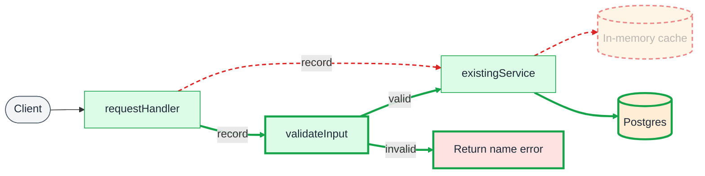

# Diff

## When to use

A change to something that exists, drawn as one diagram holding both versions: what only today has, what only the change adds, and what both share. Use it when the reader has to see what the change removes as well as what it adds, such as a step moving, a store being replaced or a path gaining a check. A diagram of something new has nothing to compare and is drawn plainly.

## Key syntax

Draw every element once, so both versions share one layout. Elements both versions have keep their palette class and nothing else. On top of the palette, mark the rest with a second class or a `linkStyle`:

| Element | Mark |
|---|---|
| Only today has it | `removed`: red dashed outline, faded |
| Only the change has it | `added`: thick green outline |
| Both have it, with a different label or shape | `changed`: thick amber outline, labelled as the change leaves it |

```
classDef removed stroke:#dc2626,stroke-width:2px,stroke-dasharray:6 4,opacity:0.55
classDef added stroke:#16a34a,stroke-width:3px
classDef changed stroke:#d97706,stroke-width:3px
```

The diff classes set only the outline, so a node keeps its palette fill and the colour still names its kind. Assign the palette class first and the diff class after it, because the later class wins the outline:

```
class Handler,Validate green
class Validate added
```

Edges take the same marks through `linkStyle`, counting edges from zero in declaration order:

```
linkStyle 1 stroke:#dc2626,stroke-width:2px,stroke-dasharray:6 4
linkStyle 2,3 stroke:#16a34a,stroke-width:3px
```

Declare every edge only today has together, then every edge only the change has, so the indices are easy to count and stay correct when an edge is added.

### Sequence diagrams

Messages take no classes. Wrap the messages only today sends in a red `rect` and the ones only the change sends in a green one:

```
rect rgba(220, 38, 38, 0.12)
    API->>Cache: create(alice)
end
rect rgba(22, 163, 74, 0.14)
    API->>DB: INSERT session
end
```

A participant only one version has stays in the diagram; its messages say which version it belongs to.

### Class diagrams

Mark a whole class with `class <Name>:::removed`, `:::added` or `:::changed`. Members take no classes, so for a changed class, name the members that change in the prose under the diagram.

## Worked example

Validation moves in front of the service, and sessions move from an in-memory cache to Postgres.



## Styling guidance

- **Both versions must read correctly on their own.** Cover the red parts and the diagram is the change; cover the green ones and it is today. A node that only exists to connect the two versions is a sign the diagram mixes two changes.
- **Say once, under the diagram, that red dashed is today only and green is the change only.** A reader who has not seen the convention reads green as the palette's module colour.
- **Keep a diff to one change.** When the diagram needs more than a handful of marks, split it into one diff per change.
