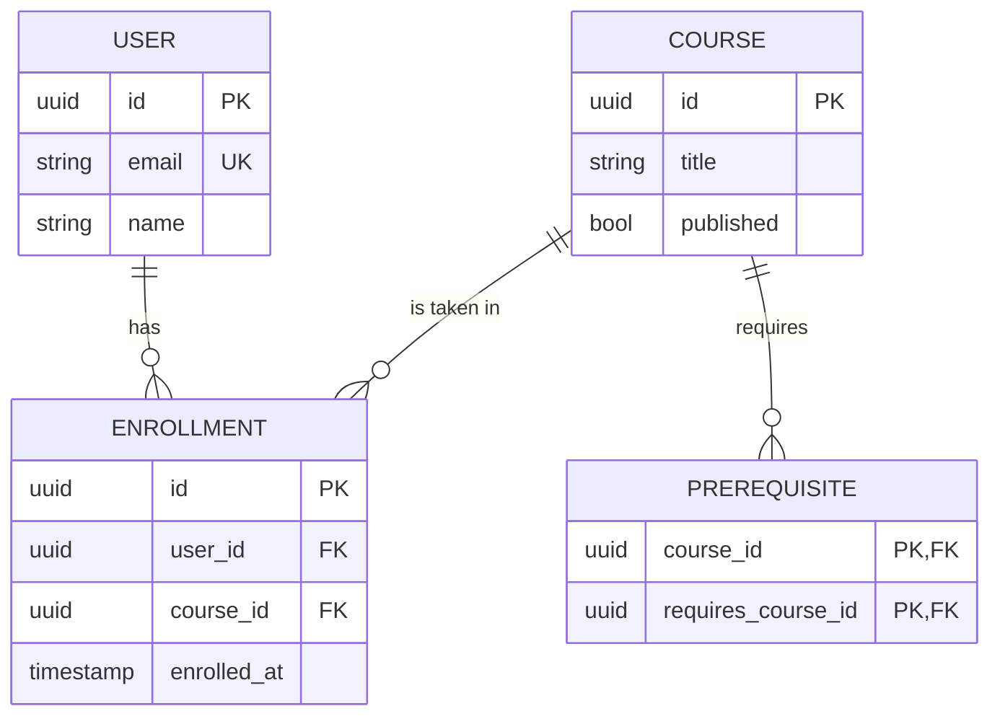

# Entity-Relationship Diagram

## When to use

Data models, database schemas and model changes: entities, their fields and the relationships between them. Use it when a plan introduces or alters tables or models.

## Key syntax

- Declare the type: `erDiagram`.
- **Relationship line**: `ENTITY_A <cardinality>--<cardinality> ENTITY_B : label`. The label names the relationship (`allows`, `places`, `contains`).
- **Cardinality** is written on each end of the line:

  | Notation | Meaning |
  |---|---|
  | `\|o` / `o\|` | zero or one |
  | `\|\|` | exactly one |
  | `}o` / `o{` | zero or more |
  | `}\|` / `\|{` | one or more |

  A solid line (`--`) is an identifying relationship; a dashed line (`..`) is a non-identifying one.
- **Attributes** go in a block after the entity: `type name key "comment"`. Keys are `PK`, `FK`, `UK`, combined with a comma: `PK, FK`. Comments are double-quoted and cannot contain double quotes.
- **No `%%` comments.** The validator rejects them in an ER diagram.

## Worked example

## Styling guidance

- **Check every cardinality.** `USER ||--o{ ENROLLMENT` reads "one user has zero or more enrollments". Read each line aloud to check it.
- **Mark keys** (`PK`, `FK`, `UK`) on attributes. They show the schema's integrity rules and the join paths.
- **Draw junction tables as entities** (like `ENROLLMENT` and `PREREQUISITE`) instead of a direct many-to-many line, the way the schema is built.
- **List only the keys and the fields the plan touches**, not every column.
- **Use the relationship label for the verb** (`requires`, `has`); quote it if it contains spaces.
