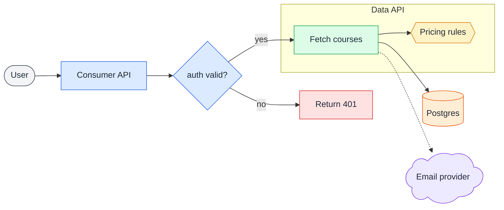

# Flowchart

## When to use

Branching logic, decision trees, request routing, and flows across a repository's services or modules, where decisions and paths matter more than the order of messages. For who calls whom and in what order, use a [sequence diagram](sequence-diagram.md).

## Key syntax

- Declare the type and direction: `flowchart TD` (top-down) or `flowchart LR` (left-right).
- Take each node's shape from the palette below and declare it as an expanded shape: `A@{ shape: cyl, label: "…" }`. The short forms `A[Rectangle]` and `B{Diamond}` draw the same `rect` and `diam`.
- Edges: `-->` solid, `==>` thick, `-.->` dotted. Labels go on the edge: `A -->|yes| B` or `A -- text --> B`.
- Fan-out shorthand: `A --> B & C` points A to both B and C.
- **Grouping**: wrap related nodes in `subgraph Name ... end` to show a boundary, such as a service, a layer or a repository. Quote the title if it has spaces: `subgraph s["Consumer API"]`.

## Worked example



## Palette

Give each kind of element the same shape and colour in every diagram, so a reader who has seen one diagram reads the next one without a legend. This palette is the default; use another shape or colour only when the diagram needs a kind of element the table does not list.

### Syntax

Declare an expanded shape on the node's first use, with the label inside the braces:

```
DB@{ shape: cyl, label: "Database<br/>of the service" }
```

Later references use the bare id.

### Which shape and colour for each element

| Element | Shape | Colour |
|---|---|---|
| A person or a client: a user, an admin, a frontend | `stadium` | grey |
| An API or service the user reaches | `rect` | blue |
| A module, a step, a part of a worker | `rect` | green |
| A durable job or a workflow | `subproc` | green |
| A background job, a scheduled task | `st-rect` | green |
| A shared piece several components use: a library, a set of rules | `hex` | amber |
| An interface or a payload crossing a boundary | `braces` | amber outline (`payload`) |
| A store: a database, a table, stored state, a warehouse you query | `cyl` | orange |
| An external service: a SaaS, a third-party API | `cloud` | violet |
| A decision | `diam` | blue |
| A wait: a timeout, a period without activity | `delay` | grey |
| A failure or a dropped outcome | `rect` | red |

A service's boundary is a `subgraph`, and its storage sits outside the subgraph.

### Colours

Copy this block into the diagram and assign each node with `class <ids> <colour>`. Declare only the colours the diagram uses.

```
classDef grey fill:#f3f4f6,stroke:#4b5563,color:#1f2937
classDef blue fill:#dbeafe,stroke:#2563eb,color:#1f2937
classDef green fill:#dcfce7,stroke:#16a34a,color:#1f2937
classDef amber fill:#fef3c7,stroke:#d97706,color:#1f2937
classDef orange fill:#ffedd5,stroke:#ea580c,color:#1f2937
classDef violet fill:#ede9fe,stroke:#7c3aed,color:#1f2937
classDef red fill:#fee2e2,stroke:#dc2626,color:#1f2937
classDef payload stroke:#d97706
```

A class with a fill sets dark text, because the fill stays light when the page turns dark and pele's dark theme would otherwise draw light text on it. A class with a dark fill sets light text, `#e5e7eb`. `braces` draws no fill, so its text sits on the page background and has to follow the theme: it takes `payload`, an amber outline with no fill and no text colour.

A state diagram takes the same colours through `classDef`; see [state-diagram.md](state-diagram.md).

## Styling guidance

- **Colour through the palette's classes**, not inline styles. Apply one class to several nodes with a comma list: `class B,C,F green`.
- **One-off node styling**, for a node the palette does not cover: `style C fill:#fef3c7,stroke:#d97706,stroke-width:3px`.
- **Highlight a path**: colour edges by their declaration order (0-indexed): `linkStyle 0,1,4 stroke:#2563eb,stroke-width:3px`. `linkStyle default` styles every edge.
- **Use `subgraph` to group** by service, layer or repository. It is the main way to show architecture boundaries in a flow.
- **Line breaks** inside labels: `A["Line one<br/>Line two"]`.
- **Match the direction to the content**: `LR` reads as a pipeline, `TD` as a decision tree. A subgraph can set its own `direction`, and keeps it when edges cross its border.
- **Keep edges from crossing where the layout allows.** When edges cross, try reordering the nodes or restructuring the diagram; some diagrams cross anyway.
