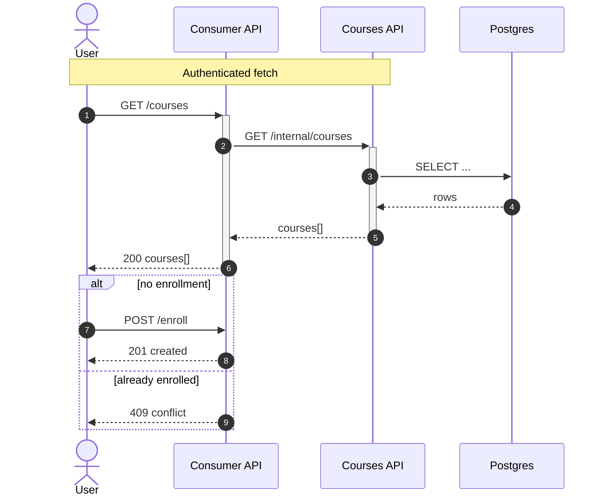

# Sequence Diagram

## When to use

Interactions over time across actors, services or APIs: who calls whom, in what order, and what comes back. Use it for a request flow that spans a frontend, a BFF or consumer API, and one or more data APIs. For branching logic with no order in time, use a [flowchart](flowchart.md).

## Key syntax

- Declare the type: `sequenceDiagram`.
- **Participants**: `actor U as User` for people (a stick figure); `participant S as Service` for systems (a box). Declaring them first fixes their left-to-right order.
- **Messages**: `->>` solid call, `-->>` dashed return, `-x` lost message. Always give a label after the colon: `U->>S: GET /courses`.
- **Activations** (the bar that shows a participant is working): append `+` to the arrow to activate the target and `-` to deactivate it on return, `Alice->>+John: request` then `John-->>-Alice: response`. Or write `activate John` and `deactivate John`.
- **Fragments**: `alt`/`else` (conditional), `opt` (optional), `loop` (repeat), `par`/`and` (parallel). Each closes with `end`.
- **Notes**: `Note over A,B: text`, `Note right of A: text`.
- **`autonumber`** numbers every message.

## Worked example



## Styling guidance

- **Draw people as `actor` and systems as `participant`.**
- **Use activations** to show which participant is working and when control returns. Write them with the `+`/`-` shorthand on the messages so each activation has its end.
- **Group a phase with `rect`**: wrap the messages of one phase in a coloured background, with a `Note over` that names it:
  ```
  rect rgba(37, 99, 235, 0.15)
      Note over U,API: Phase 1, request
      ...
  end
  ```
  Use a different translucent colour per phase; an alpha of about 0.15 to 0.25 keeps the messages readable. `rect` blocks can nest.
- **Use `autonumber`** when the prose refers to steps by number.
- **Declare participants in the order they should appear** so message lines cross as little as possible.
- **Break long notes with `<br/>`.** Notes do not wrap; see the rendering rules in `SKILL.md`.
