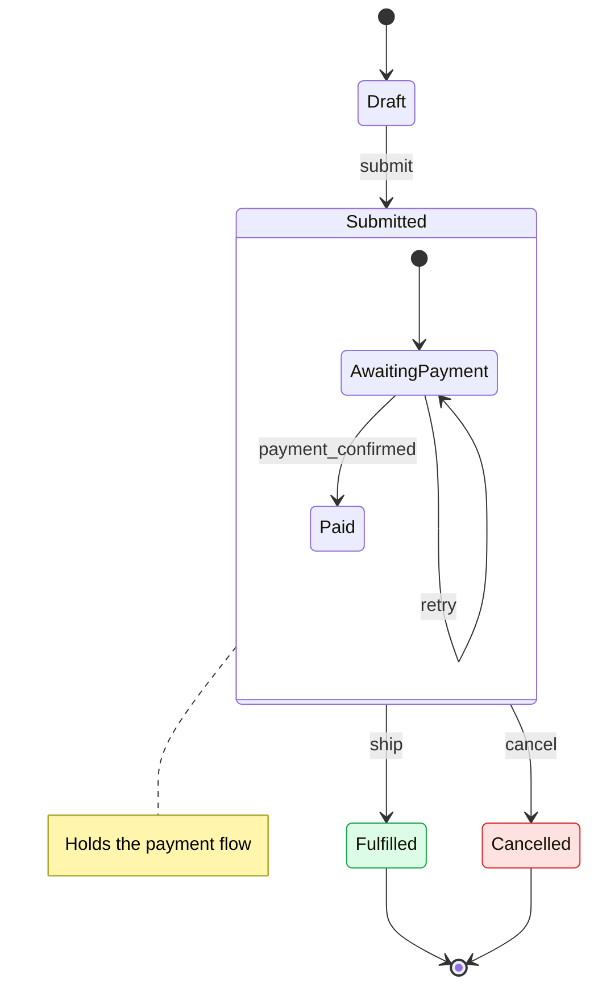

# State Diagram

## When to use

The lifecycle of an entity: how an order, a payment, a subscription or a job moves between statuses, and which event triggers each move. If you are writing "when X happens it goes from pending to active", draw a state diagram.

## Key syntax

- Declare the type: `stateDiagram-v2`.
- **Start and end**: `[*] --> First` marks the entry; `Last --> [*]` marks the end.
- **Transitions** carry the triggering event as a label: `Pending --> Active : payment_confirmed`.
- **Named states with descriptions**: `state "Waiting for payment" as Pending`.
- **Composite states** group substates inside a parent, for a state that has its own internal lifecycle:
  ```
  state Active {
      [*] --> Running
      Running --> Paused : pause
      Paused --> Running : resume
  }
  ```
- **Choice, fork and join**: `state c <<choice>>` for a branch, `state f <<fork>>` and `state j <<join>>` for parallel paths.
- **Notes**: `note right of StateName : text`.
- **Colour**: `classDef` and `class` work as in a flowchart: `classDef red fill:#fee2e2,stroke:#dc2626` and `class Cancelled red`.

## Worked example



## Styling guidance

- **Colour with the palette** in [flowchart.md](flowchart.md). Use the same colours for the same meaning: red for a failed or dropped state, grey for a wait, green for a state where work runs.
- **Use composite states for substates** when a status has its own internal lifecycle, as `Submitted` holds the payment steps above. The top level then shows only the statuses, and the substates appear inside the composite state.
- **Label every transition** with the event or condition that causes it. An unlabeled transition leaves the reader guessing what triggers the change.
- **Use `<<choice>>`** for one decision point with mutually exclusive outgoing transitions, and **`<<fork>>` / `<<join>>`** only when the entity does things in parallel.
- **A self-transition** (`AwaitingPayment --> AwaitingPayment : retry`) shows a retry that does not leave the state.
- **Add a `note`** to explain a state or an invariant the diagram cannot express in its structure.
- **Never put a `;` in a note or a transition label.** It ends the statement and the rest renders as stray states; use a comma.
